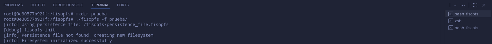
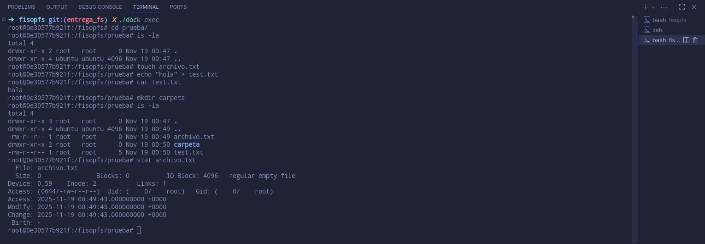
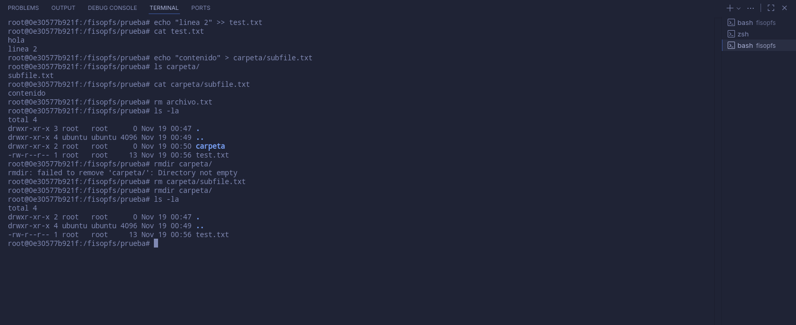
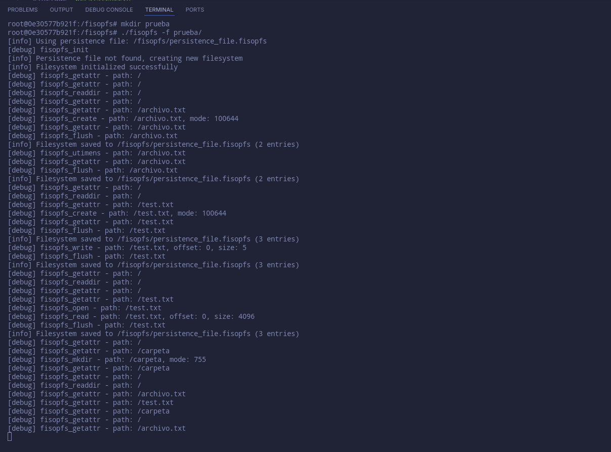
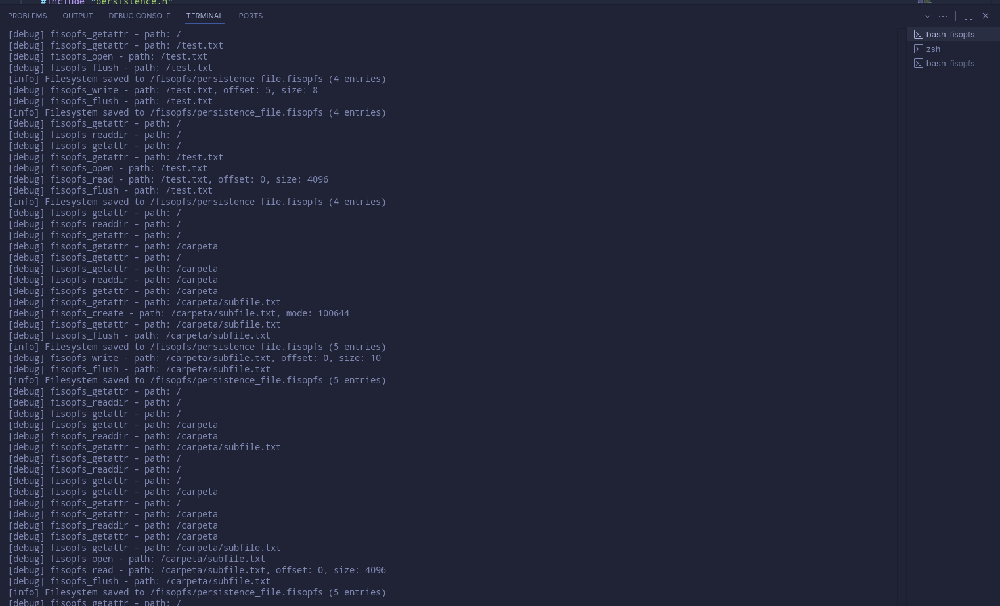
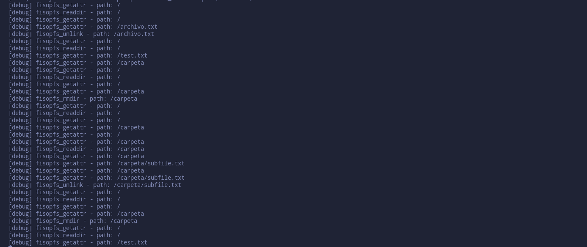
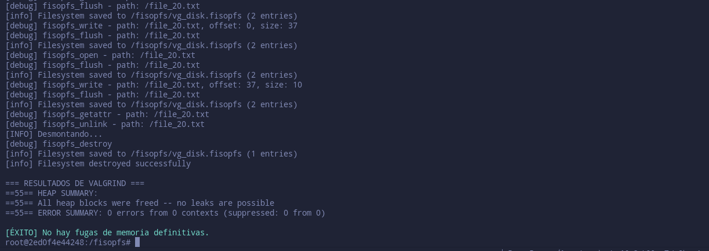

# fisop-fs

Lugar para respuestas en prosa y documentación del TP.

## Implementación

## Operaciones requeridas

    El sistema de archivos debe soportar las siguientes funcionalidades:
        Archivos:
            creación (touch y redirecciones echo "hola" > archivo)
            lectura (con cat, more, less, etc)
            escritura (trunc > y append >>)
            borrado (con rm o unlink)
        Directorios:
            creación (con mkdir)
            lectura, incluyendo los pseudo-directorios . y .. (con ls)
            borrado (con rmdir, debe estar vacío)
        Estadísticas (con stat)
            Incluir y mantener fecha de último acceso y última modificación
            Asumir que todos los archivos son creados por el usuario y grupo actual (ver getuid(2) y getgid(2))
    La creación/lectura/escritura de archivos debe soportar contenido binario.
    La creación de directorios debe soportar al menos un nivel de recursión, es decir, directorio raíz y sub-directorio.


Para cada una de las funcionalidades pedidas, se espera que la misma se pueda corroborar montando el sistema de archivos e interactuando con el mismo a través de una terminal bash, de la misma forma que se haría con cualquier otro filesystem.

AYUDA: Una buena forma de saber qué operaciones hacen falta es implementar las mismas vacías con printf de debug; y montar el filesystem en primer plano: ./fisopfs -f .... Esto permitirá loggear todas las operaciones/syscalls que generan los procesos al interactuar con el sistema de archivos.

En caso de error o funcionalidad no implementada, el sistema de archivos debe escribirlo por pantalla (basta con un printf a stderr, o con el prefijo [debug]) y devolver el error apropiado. Pueden tomar los errores definidos en errno.h (ver errno(3)) como inspiración, viendo qué errores arrojan otros sistemas de archivos. Algunas opciones útiles son: ENOENT, ENOTDIR, EIO, EINVAL, EBIG y ENOMEM, entre otros.

## Respuesta y explicación sobre las operaciones requeridas:


**Archivos:**
- Creación: `fs_create_file()` maneja tanto `touch` como redirecciones. Inicializa metadatos (uid, gid, mode, timestamps) y crea una entrada en el array de entradas.
- Lectura: `fs_read_file()` lee datos desde el campo `data` del archivo, maneja offsets y actualiza `atime`.
- Escritura: `fs_write_file()` soporta escritura en cualquier posición (offset), realoca memoria dinámicamente si es necesario, maneja huecos con zeros, y actualiza `mtime`. Soporta tanto truncate (>) como append (>>).
- Borrado: `fs_unlink_file()` libera la memoria del contenido, actualiza `used_space`, y remueve la entrada del array.

**Directorios:**
- Creación: `fs_create_dir()` crea directorios con `nlink=2`, verifica que el padre exista, y actualiza el `nlink` del padre.
- Lectura: `fs_read_dir()` retorna lista de nombres de entradas hijas basándose en `parent_idx`. Los pseudo-directorios `.` y `..` son agregados por `fisopfs_readdir()`.
- Borrado: `fs_remove_dir()` verifica que el directorio esté vacío antes de borrarlo, y decrementa el `nlink` del padre.

**Estadísticas:**
- `fs_getattr()` llena el `struct stat` con todos los metadatos (uid, gid, mode, size, timestamps, nlink).
- Los timestamps se actualizan automáticamente: `atime` al leer, `mtime` al escribir, `ctime` al cambiar metadatos.
- Se usa `getuid()` y `getgid()` para asignar owner al crear archivos/directorios.

**Contenido binario:** Todas las operaciones de lectura/escritura usan `memcpy()` y no asumen datos de texto, por lo que funcionan correctamente con contenido binario.

**Directorios anidados:** Se soportan múltiples niveles de recursión mediante el campo `parent_idx` que enlaza cada entrada con su directorio padre. El límite está definido por `MAX_DIR_DEPTH=8`.

## Representación del sistema de archivos

El sistema de archivo implementado debe existir en memoria RAM durante su operación. La estructura en memoria que se utilice para lograr tal funcionalidad es enteramente a diseño del grupo. Deberá explicarse claramente, con ayuda de diagramas, en el informe del trabajo (i.e. archivo fisopfs.md); las decisiones tomadas y el razonamiento detrás de las mismas.

La primera parte, consistirá en el diseño de las estructuras que almacenarán toda la información, y cómo se accederán en cada una de las operaciones. Para luego implementarlas en la segunda parte del trabajo práctico.

## Documentación de diseño

    Se deben explicar los distintos aspectos de diseño:
        Las estructuras en memoria que almacenarán los archivos, directorios y sus metadatos
        Cómo el sistema de archivos encuentra un archivo específico dado un path
        Todo tipo de estructuras auxiliares utilizadas
        El formato de serialización del sistema de archivos en disco (ver siguiente sección)
        Cualquier otra decisión/información que crean relevante

AYUDA: Se recomienda utilizar una estructura flat para los directorios, limitando el filesystem a un único nivel de recursión en los directorios. O bien implementar un esquema con inodes similar a los sistemas de archivo Unix-like, y permitir múltiples niveles de directorios. De todas formas, es recomendable definir un límite en la longitud del path o en la cantidad de directorios anidados soportados.

AYUDA 2: Definir un tamaño máximo para el sistema de archivos, y arrojar ENOSPC (No space left on device), o similar, si nos excedemos del mismo. Se recomienda utilizar arreglos de tamaño estático para tal fin, para simplificar el manejo de memoria.

## Respuesta y explicación sobre la documentación de diseño:

### Estructuras en memoria

El filesystem usa una estructura flat (array) para almacenar todas las entradas:

```c
typedef struct {
    char path[MAX_PATH];          // Path completo: "/dir/file.txt"
    char name[MAX_FILENAME];      // Solo nombre: "file.txt"
    entry_type_t type;            // ENTRY_FILE o ENTRY_DIR
    uid_t uid;
    gid_t gid;
    mode_t mode;
    size_t size;
    time_t atime, mtime, ctime;
    int nlink;
    int parent_idx;               // Índice del directorio padre (-1 para raíz)
    char *data;                   // Puntero a contenido (solo para archivos)
} fs_entry_t;

typedef struct {
    fs_entry_t entries[MAX_FILES];  // Array estático de entradas
    int entry_count;                 // Número de entradas usadas
    size_t used_space;               // Espacio total usado por archivos
    bool initialized;
} filesystem_t;
```

**Decisiones de diseño:**

1. **Array estático:** Usamos `entries[MAX_FILES]` para simplificar el manejo de memoria. Límite de 128 archivos/directorios.

2. **Path completo + nombre:** Guardamos ambos para optimizar búsquedas (por path) y listados (por nombre).

3. **parent_idx en lugar de inodes:** Cada entrada apunta a su padre mediante un índice. Esto permite múltiples niveles de directorios sin complejidad adicional.

4. **Memoria dinámica solo para data:** El contenido de archivos se aloca con `malloc()`/`realloc()` según sea necesario. Los metadatos están en memoria estática.

### Búsqueda de archivos

`fs_find_entry()` realiza búsqueda lineal comparando `path` completo:
```c
for (int i = 0; i < fs->entry_count; i++) {
    if (strcmp(fs->entries[i].path, path) == 0)
        return i;
}
```

La raíz "/" siempre está en `entries[0]` y se retorna directamente sin búsqueda.

**Complejidad:** O(n) donde n es el número de entradas. Suficiente para MAX_FILES=128.

### Estructuras auxiliares

- `fs_split_path()`: Separa un path en directorio padre y nombre usando `strrchr()`.
- `fs_is_root()`: Verifica si un path es "/".
- `fs_path_depth()`: Cuenta las '/' en un path para validar profundidad máxima.

## Límites del sistema
```c
#define MAX_FILES 128              // Máximo número de archivos/directorios
#define MAX_FILENAME 256           // Longitud máxima de nombre
#define MAX_PATH 512               // Longitud máxima de path completo
#define MAX_FILE_SIZE (10 * 1024 * 1024)   // 10MB por archivo
#define MAX_FS_SIZE (50 * 1024 * 1024)     // 50MB total
#define MAX_DIR_DEPTH 8            // Máxima profundidad de directorios
```

Se retorna `-ENOSPC` cuando se exceden estos límites.

## Persistencia en disco

    El filesystem se persiste en disco, en un único archivo, de extensión .fisopfs
    Al lanzar el filesystem, se debe especificar un nombre de archivo, si no se hace, se elige uno por defecto
        Esto es provisto por el esqueleto mediante la opción --filedisk
    Del archivo especificado se lee todo el filesystem, y se inicializan las estructuras acordemente (esto ocurre en la función init)
    Si ocurre un flush o cuando el sistema de archivos se desmonta (esto ocurre en la función destroy), la data debe persistirse en el archivo nuevamente
    Soporta ejecución en background (cuando no se especifica -f), en particular:
        maneja el path absoluto para el archivo de persistencia

## Respuesta y explicación sobre la persistencia en disco:

### Formato de serialización

El archivo `.fisopfs` tiene la siguiente estructura:
```
+------------------+
| Magic: "FISO"    | 4 bytes
+------------------+
| Version: 1       | 4 bytes (int)
+------------------+
| Entry count      | 4 bytes (int)
+------------------+
| Used space       | 8 bytes (size_t)
+------------------+
| Entry 0 metadata | sizeof(fs_entry_t) - sizeof(char*)
+------------------+
| Entry 0 data     | entry[0].size bytes (si es archivo)
+------------------+
| Entry 1 metadata |
+------------------+
| Entry 1 data     | (si es archivo)
+------------------+
| ...              |
+------------------+
```

**Proceso de guardado (`persistence_save()`):**

1. Escribir header (magic, versión, entry_count, used_space)
2. Para cada entrada:
   - Escribir metadatos usando `offsetof(fs_entry_t, data)` para excluir el puntero
   - Si es archivo y tiene contenido, escribir `entry->size` bytes de `entry->data`

**Proceso de carga (`persistence_load()`):**

1. Verificar magic number "FISO"
2. Leer header y validar versión
3. Para cada entrada:
   - Leer metadatos
   - Si es archivo y `size > 0`, alocar memoria y leer contenido
   - Copiar entrada al array en memoria

**Manejo de errores:** Si falla la lectura o aloca de memoria, se liberan todas las entradas ya cargadas para evitar memory leaks.

**Path absoluto:** En `main()`, se construye el path absoluto del archivo de persistencia usando `getcwd()`, permitiendo ejecución en background.

### Validación

`persistence_is_valid()` verifica que un archivo sea válido leyendo los primeros 4 bytes y comparando con "FISO".

## Modularización

Es recomendable tener la lógica del filesystem en otro archivo (por ejemplo fs.c) y que fisopfs.c llame a estas primitivas. Dichas funciones no deberían recibir ningún tipo de dato que sea de FUSE ya que ésto romperían la abstracción.

## Explicación de cómo modularizamos y separamos la lógica del filesystem:

El código está organizado en tres módulos principales:

**1. fs.c / fs.h - Lógica pura del filesystem**

Contiene todas las operaciones sobre el filesystem sin dependencias de FUSE:
- Operaciones de archivos: `fs_create_file()`, `fs_read_file()`, `fs_write_file()`, etc.
- Operaciones de directorios: `fs_create_dir()`, `fs_read_dir()`, `fs_remove_dir()`
- Utilidades: `fs_find_entry()`, `fs_split_path()`, `fs_getattr()`

**Características:**
- No incluye ningún header de FUSE
- Funciona con estructuras propias (`filesystem_t`, `fs_entry_t`)
- Retorna códigos de error estándar de Linux (ENOENT, EINVAL, etc.)
- Puede ser testeado independientemente de FUSE

**2. persistence.c / persistence.h - Serialización**

Maneja la persistencia a disco:
- `persistence_save()`: Serializa el filesystem a archivo .fisopfs
- `persistence_load()`: Deserializa desde archivo
- `persistence_file_exists()`, `persistence_is_valid()`: Validaciones

**3. fisopfs.c - Capa de integración con FUSE**

Implementa las operaciones de FUSE delegando a fs.c:
```c
static int fisopfs_read(const char *path, char *buffer, 
                        size_t size, off_t offset, 
                        struct fuse_file_info *fi)
{
    // Delegar a fs.c (sin pasar datos de FUSE)
    return fs_read_file(&g_fs, path, buffer, size, offset);
}
```

**Ventajas de esta modularización:**

- **Separación de concerns:** La lógica del filesystem no conoce FUSE
- **Testeable:** `fs.c` puede testearse sin montar un filesystem
- **Mantenible:** Cambios en FUSE no afectan la lógica core
- **Reusable:** `fs.c` podría usarse con otros frameworks

**Compilación modular:**

El Makefile compila cada módulo por separado:
```makefile
OBJS = fisopfs.o fs.o persistence.o

fisopfs: $(OBJS)
    $(CC) $(CFLAGS) $(FUSE_CFLAGS) $^ $(FUSE_LIBS) -o $@
```

## Pruebas y salidas de ejemplo

Como parte de la implementación de fisopfs también será necesario incorporar pruebas de caja negra sobre lo implementado. Las mismas deben consistir de una serie de secuencias de comandos pensadas para generar un escenario de prueba, junto con la salida esperada del mismo. Un ejemplo, es lo presentado en la sección “Software necesario”.

Cada funcionalidad implementada debe incluir una prueba asociada. Las salidas de las pruebas deben incluirse como una sección en el informe.

Es altamente recomendable pensar y escribir las pruebas incluso antes de arrancar con la implementación, para tener una guía del comportamiento del sistema.

## Explicación de las pruebas que implementamos para probar el correcto funcionamiento:

### Pruebas automáticas

Implementamos `tests/test_fisopfs.sh`, un script bash con 30 pruebas automatizadas que cubren todas las funcionalidades.

**Estructura de las pruebas:**

1. **Setup automático:** Monta el filesystem con archivo de persistencia de prueba
2. **Pruebas básicas:** Listado, creación de archivos/directorios
3. **Pruebas de lectura/escritura:** Redirección, append, contenido binario
4. **Pruebas de borrado:** Archivos, directorios vacíos y no vacíos
5. **Pruebas de persistencia:** Desmonta, remonta y verifica que los datos persistan
6. **Pruebas de límites:** Múltiples archivos, tamaños
7. **Cleanup automático:** Desmonta y limpia al terminar

**Ejemplo de salida:**
```bash
[TEST] 5. Escribir en archivo (redirección >)
[debug] fisopfs_create - path: /hello.txt, mode: 100644
[debug] fisopfs_write - path: /hello.txt, offset: 0, size: 13
[✓] Escritura con > exitosa

[TEST] 6. Leer contenido de archivo
[debug] fisopfs_read - path: /hello.txt, offset: 0, size: 4096
[✓] Lectura correcta: 'Hola fisopfs'

[TEST] 19. Desmontar filesystem
[info] Filesystem saved to /fisopfs/test_filesystem.fisopfs (4 entries)
[✓] Filesystem desmontado

[TEST] 21. Remontar filesystem
[info] Filesystem loaded from /fisopfs/test_filesystem.fisopfs (4 entries, 47 bytes used)
[✓] Filesystem remontado

[TEST] 22. Verificar persistencia de datos
[✓] Datos persistieron correctamente
```

**Resumen final de ejecución:**
```
========================================
         RESUMEN DE PRUEBAS
========================================
Pasadas: 30
Falladas: 0
========================================
TODO OK
```

**Pruebas implementadas:**

- Operaciones básicas (touch, cat, echo, ls, mkdir, rm, rmdir)
- Directorios anidados (hasta 2 niveles probados, soporta hasta 8)
- Append (>>)
- Estadísticas (stat)
- Persistencia completa (guardar, cargar, verificar)
- Contenido binario (dd de 1024 bytes)
- Múltiples archivos (10 archivos simultáneos)
- Escritura en posiciones específicas (offsets)

Todas las pruebas son de caja negra: interactúan con el filesystem montado usando comandos estándar de bash, sin acceder a la implementación interna.

### Pruebas manuales

Antes de hacer las pruebas automáticas, habíamos montado el filesystem y ejecutado comandos básicos manualmente, para chequear el funcionamiento general del filesystem. Adjuntamos capturas de la salida al probar el filesystem en la terminal de manera interactiva, así se ve cómo funciona.

### 1. Inicialización del Filesystem (primera terminal)

*Figura 1: El filesystem se monta exitosamente y muestra el directorio raíz vacío*

### 2. Operaciones Básicas (segunda terminal)

*Figura 2: Comandos touch, echo, cat funcionando correctamente*

### 3. Algunas operaciones más (segunda terminal)

*Figura 3: Soporte para múltiples niveles de directorios*

### 4. Salida de los debugs (primera terminal)

### En la siguiente imagen se muestra la salida que tienen los [debug] de las operaciones realizadas en la captura de la Figura 1.


### En la siguiente imagen se muestra la salida que tienen los [debug] de las operaciones realizadas en la captura de la Figura 2.




### Pruebas de fuga de memoria (valgrind)

Para garantizar la robustez del sistema, se ejecutaron pruebas de memoria mediante el script test_leaks.sh que realiza las siguientes verificaciones:
Pruebas implementadas

1. Prueba básica de montaje/desmontaje:
    - Montaje inicial del filesystem
    - Desmontaje inmediato
    - Verificación que no hay fugas en operaciones mínimas

2. Prueba de creación y eliminación:
    - Creación de archivos con touch
    - Creación de directorios con mkdir
    - Eliminación de archivos con rm
    - Eliminación de directorios vacíos con rmdir

3. Prueba de operaciones de E/S:
    - Escritura de archivos con redirección (echo "contenido" > archivo)
    - Lectura de archivos con cat
    - Operaciones de append (echo "mas" >> archivo)

4. Prueba de persistencia:
    - Montaje del filesystem
    - Creación de archivos y directorios
    - Desmontaje y nuevo montaje
    - Verificación que la persistencia no genera fugas

5. Prueba de comandos secuenciales:
    - Secuencia de operaciones comunes (mkdir, touch, echo, cat, rm)
    - Verificación de limpieza después de múltiples operaciones

Metodología de ejecución

Cada prueba ejecuta valgrind con:

```bash
valgrind --leak-check=full --show-leak-kinds=all --track-origins=yes --error-exitcode=1
```

El script verifica que el código de salida de valgrind sea 0 (sin fugas detectadas).

**Resultados específicos obtenidos**




## Compilación

**En Docker**
```bash
./dock build

./dock run

make local

./fisopfs -f prueba/
```
**Localmente:**
```bash
# sudo apt install pkg-config libfuse2 libfuse-dev

make local

./fisopfs -f prueba/
```

